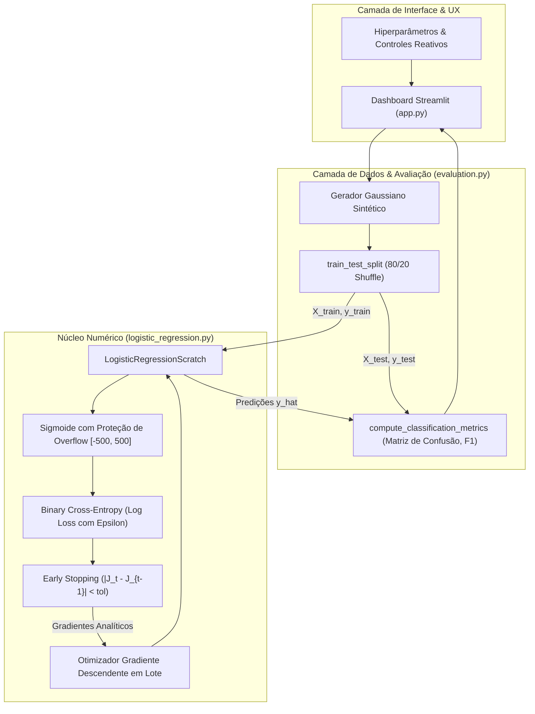
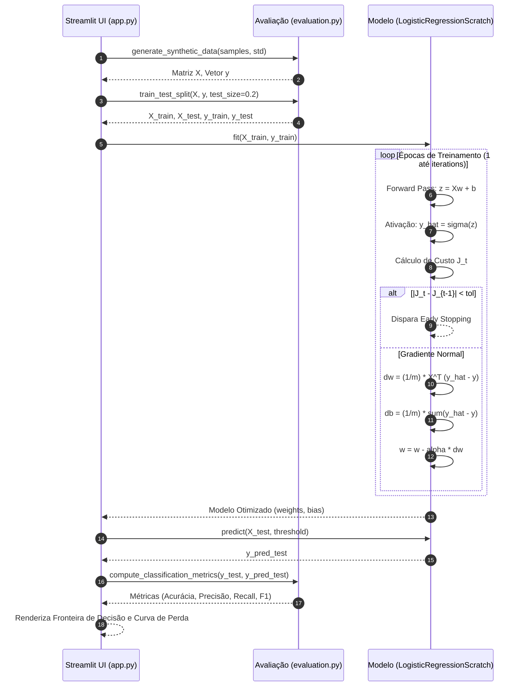
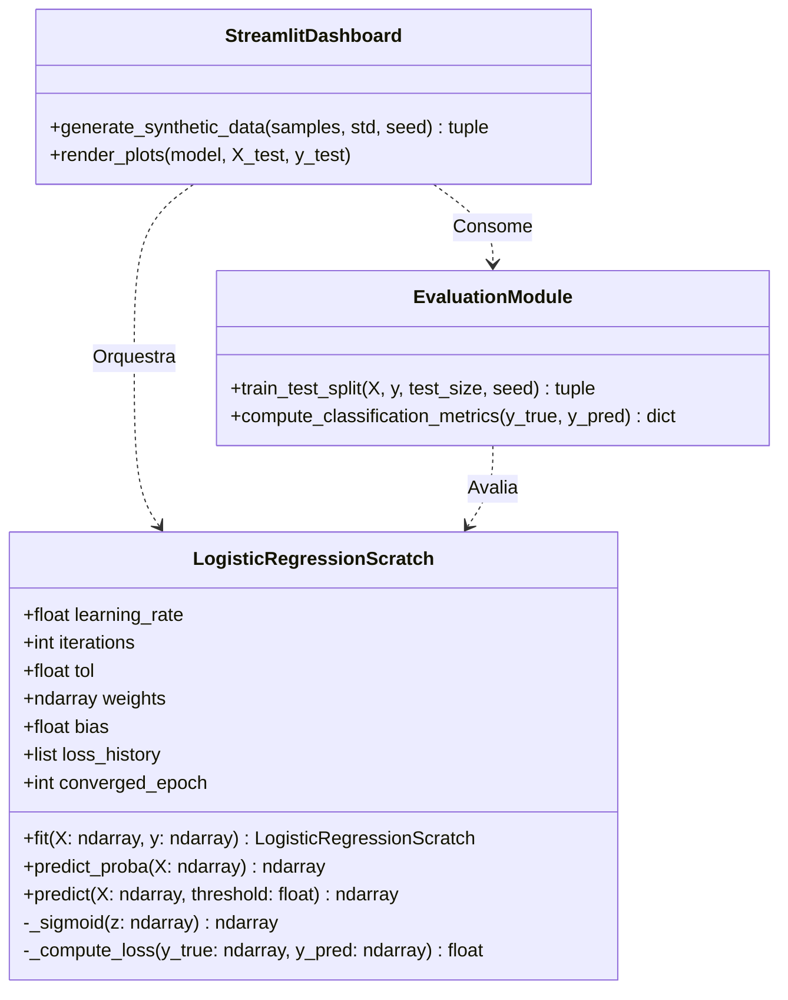

# Arquitetura e Engenharia do Sistema: Regressão Logística Vetorial

## 1. Visão Geral e Limites de Execução
O sistema consiste em um motor analítico desacoplado para aprendizado supervisionado binário, focado em estabilidade de ponto flutuante, vetorização e interpretabilidade através de uma interface interativa.

---

## 2. Diagrama de Sequência: Ciclo de Otimização e Inferência

---

## 3. Topologia e Modelo de Domínio (Entidades Numéricas)

---

## 4. Referências Formais e Literatura
1. **Bishop, Christopher M.** (2006). *Pattern Recognition and Machine Learning*. Springer. Capítulo 4: Linear Models for Classification (Seção 4.3 - Probabilistic Discriminative Models).
2. **Hastie, Trevor; Tibshirani, Robert; Friedman, Jerome.** (2009). *The Elements of Statistical Learning: Data Mining, Inference, and Prediction*. 2ª Edição. Springer. Capítulo 4: Linear Methods for Classification.
3. **Goodfellow, Ian; Bengio, Yoshua; Courville, Aaron.** (2016). *Deep Learning*. MIT Press. Capítulo 5: Machine Learning Basics (Seção 5.7 - Supervised Learning Algorithms).
4. **IEEE 754-2019:** *Standard for Floating-Point Arithmetic*. Tratamento numérico de subtrações catastróficas, saturações assintóticas e prevenção de NaN/inf.
